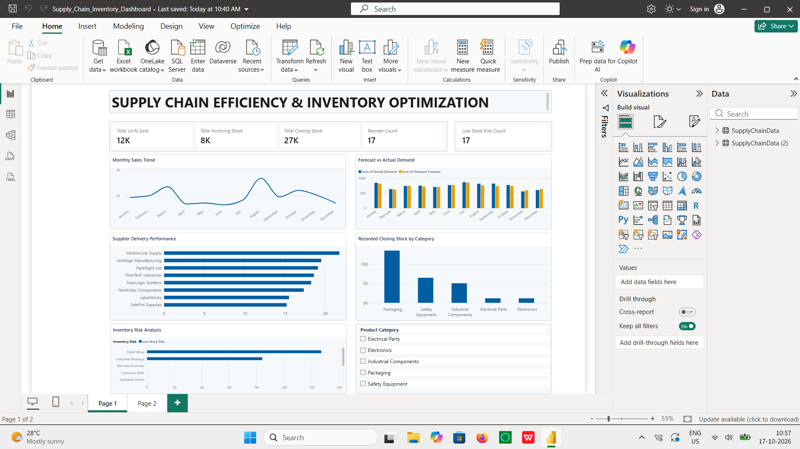
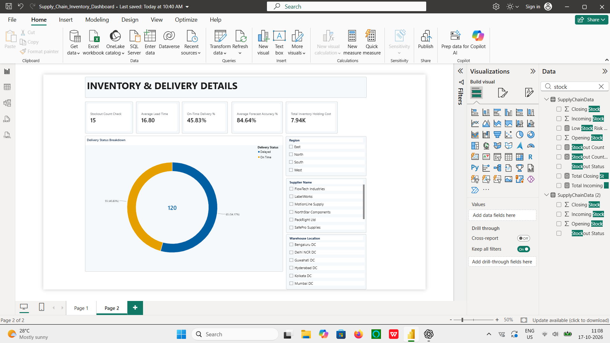

# 📦 Supply Chain Efficiency & Inventory Optimization Dashboard

An interactive Power BI dashboard for analyzing inventory levels, sales trends, supplier delivery performance, and demand forecasting.


---

## 📊 Dashboard Preview

### Page 1 — Supply Chain Efficiency & Inventory Optimization



### Page 2 — Inventory & Delivery Details



*Executive dashboard developed using Microsoft Power BI Desktop.*

---

## 📌 Project Overview

Supply chain and inventory management require continuous monitoring of stock levels, product demand, and supplier delivery performance.

This project demonstrates how Power BI can transform structured sample data into an interactive dashboard that helps users explore operational trends and identify potential inventory risks.

The dashboard includes KPI cards, trend analysis, demand comparisons, supplier delivery analysis, and inventory risk classification.

> **Dataset disclaimer:** This project uses synthetic sample data for educational and portfolio purposes. It does not represent the actual operations of a company.

---

## 🎯 Project Objectives

- Monitor total units sold and incoming inventory.
- Analyze recorded closing stock across product categories.
- Identify records requiring replenishment.
- Highlight records classified as low-stock risk.
- Compare forecast demand with actual demand.
- Examine supplier delivery performance.
- Present operational metrics through an interactive dashboard.

---

## 🛠️ Tools & Technologies

| Tool | Purpose |
|---|---|
| Microsoft Power BI Desktop | Dashboard development and visualization |
| Power Query | Data inspection and preparation |
| DAX | KPI calculations and inventory risk classification |
| CSV | Source dataset |
| GitHub | Version control and project portfolio |

---

## 📈 Key Performance Indicators

| KPI | Description |
|---|---|
| Total Units Sold | Sum of recorded units sold |
| Total Incoming Stock | Sum of incoming inventory |
| Total Closing Stock | Sum of recorded closing stock |
| Reorder Count | Number of records marked as requiring reorder |
| Low Stock Risk Count | Number of records classified as low-stock risk |
| Stockout Count | Number of records marked as stockout |
| Average Lead Time | Average recorded lead time, in days |
| On-Time Delivery % | Share of records labeled “On Time” |
| Average Forecast Accuracy % | Average recorded forecast accuracy |
| Total Inventory Holding Cost | Sum of recorded inventory holding cost |

**KPI note:** Reorder, low-stock risk, and stockout counts represent product-month records, not necessarily unique products or individual events. On-Time Delivery % is calculated from the available delivery-status records.

---

## 📊 Dashboard Analysis

### 1. Monthly Sales Trend
Examines changes in recorded units sold over time.

### 2. Forecast vs Actual Demand
Compares forecast demand with actual demand.

### 3. Supplier Delivery Performance
Explores delivery performance using the available supplier and delivery fields.

### 4. Closing Stock by Category
Compares recorded closing inventory across product categories.

### 5. Inventory Risk Analysis
Shows records classified into low-stock risk and sufficient-stock categories.

### 6. Delivery Status Breakdown
Visualizes the distribution of records labeled “On Time” and “Delayed.”

### 7. Interactive Filters
Allows users to filter the report by available categories, regions, suppliers, and warehouse locations.

---

## 🗂️ Dataset Information

| Attribute | Details |
|---|---|
| File format | CSV |
| Number of records | 120 |
| Number of columns | 26 |
| Reporting period | January–December 2025 |
| Data type | Synthetic sample data |

The dataset includes product information, suppliers, warehouse locations, inventory quantities, sales, delivery information, and demand forecasts.

---

## ⚙️ Methodology

1. Imported the CSV dataset into Power BI Desktop.
2. Inspected the dataset using Power Query.
3. Checked the dataset for empty values, errors, and exact duplicate rows.
4. Created DAX measures for KPI calculations.
5. Developed an inventory risk classification.
6. Built visuals for sales, inventory, demand, and delivery analysis.
7. Arranged the visuals into a two-page dashboard.
8. Reviewed the report before preparing it for publication.

---

## 🚀 How to Use This Project

1. Download or clone this repository.
2. Open `Supply_Chain_Inventory_Dashboard.pbix` using Microsoft Power BI Desktop.
3. If Power BI cannot locate the source dataset, update the source path to the downloaded CSV file.
4. Refresh the dataset if required.
5. Explore the dashboard visuals and available filters.

---

## ⚠️ Data Limitations

- The dataset is synthetic and does not represent real business transactions.
- The dataset contains monthly product observations rather than a complete daily transaction history.
- Reorder, inventory risk, and stockout counts represent records rather than unique products or verified individual events.
- Delivery analysis is limited to the available delivery-status fields.
- The dataset does not provide all the information required to calculate metrics such as true cost-based inventory turnover or economic order quantity.

The dashboard is intended for learning and demonstration, not as a replacement for validated operational data.

---

## 📁 Repository Structure

```text
supply-chain-efficiency-inventory-optimization/
├── README.md
├── Supply_Chain_Inventory_Dashboard.pbix
├── supply_chain_inventory_sample_data.csv
├── dashboard_page1.png
├── dashboard_page2.png
└── dashboard_screenshot.png