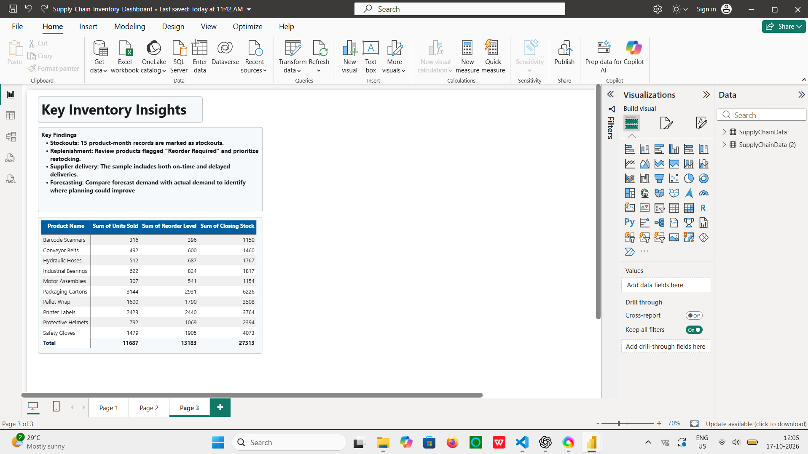

# 📦 Supply Chain Efficiency & Inventory Optimization Dashboard

An interactive Power BI dashboard for analyzing inventory levels, sales trends, supplier delivery performance, and demand forecasting.


---

## 📊 Dashboard Preview

### Page 1 — Supply Chain Efficiency & Inventory Optimization


### Page 2 — Inventory & Delivery Details


### Page 3 — Business Insights



*Dashboard developed using Microsoft Power BI Desktop.*

---

## 📌 Project Overview

Supply chain and inventory management require continuous monitoring of stock levels, product demand, and supplier delivery performance.

This project demonstrates how Microsoft Power BI can transform structured sample data into an interactive report that helps users explore operational trends and identify potential inventory risks.

The report includes KPI cards, sales trend analysis, forecast-versus-actual demand comparisons, supplier delivery analysis, inventory risk classification, product-level inventory details, and a business insights page.

> **Dataset disclaimer:** This project uses synthetic sample data for educational and portfolio purposes. It does not represent the actual operations of a company.

---

## 🎯 Project Objectives

- Monitor total units sold and incoming inventory.
- Analyze recorded closing stock across product categories.
- Identify records requiring replenishment.
- Highlight records classified as low-stock risk.
- Compare forecast demand with actual demand.
- Examine supplier delivery performance using the available fields.
- Explore inventory information at product level.
- Present operational metrics through an interactive Power BI report.

---

## 🛠️ Tools & Technologies

| Tool | Purpose |
|---|---|
| Microsoft Power BI Desktop | Dashboard development and visualization |
| Power Query | Data inspection and preparation |
| DAX | KPI calculations and inventory risk classification |
| CSV | Source dataset |
| GitHub | Version control and project portfolio |

---

## 📈 Key Performance Indicators

| KPI | Description |
|---|---|
| Total Units Sold | Sum of recorded units sold |
| Total Incoming Stock | Sum of incoming inventory |
| Total Closing Stock | Sum of recorded closing stock |
| Reorder Count | Number of records marked as requiring reorder |
| Low Stock Risk Count | Number of records classified as low-stock risk |
| Stockout Count | Number of records marked as stockout |
| Average Lead Time | Average recorded lead time, in days |
| On-Time Delivery % | Share of records labeled “On Time” |
| Average Forecast Accuracy % | Average recorded forecast accuracy |
| Total Inventory Holding Cost | Sum of recorded inventory holding cost |
| Average Inventory Turnover | Average of the dataset's recorded inventory turnover ratio |
| Estimated Days Inventory on Hand | Illustrative estimate derived from the recorded turnover ratio |

> **KPI interpretation note:** Reorder, low-stock risk, and stockout counts represent product-month records, not necessarily unique products or individual events. On-Time Delivery % is calculated from the available delivery-status records. The inventory turnover field's calculation basis is not documented, so the turnover and derived days-in-inventory measure should be treated as illustrative rather than validated operational metrics.

---

## 📊 Dashboard Analysis

### 1. Monthly Sales Trend

Examines changes in recorded units sold over time and helps users explore monthly sales patterns.

### 2. Forecast vs. Actual Demand

Compares forecast demand with actual demand to explore differences between planned and recorded demand.

### 3. Supplier Delivery Performance

Explores delivery performance using the supplier and delivery-status information available in the dataset.

### 4. Closing Stock by Category

Compares recorded closing inventory across product categories.

### 5. Inventory Risk Analysis

Displays records classified into low-stock risk and sufficient-stock categories.

### 6. Delivery Status Breakdown

Visualizes the distribution of records labeled “On Time” and “Delayed.”

### 7. Interactive Filters

Allows users to filter report visuals using available categories, regions, suppliers, and warehouse locations.

### 8. Product-Level Inventory Matrix

Displays product-level information, including units sold, closing stock, and reorder level, to support inventory review.

### 9. Business Insights

Summarizes observations from the sample data, including stockout records, replenishment flags, supplier delivery statuses, and forecast-versus-actual demand comparisons.

---

## 🗂️ Dataset Information

| Attribute | Details |
|---|---|
| File format | CSV |
| Number of records | 120 |
| Number of columns | 26 |
| Reporting period | January–December 2025 |
| Data type | Synthetic sample data |

The dataset includes product information, suppliers, warehouse locations, inventory quantities, sales, delivery information, and demand forecasts.

---

## ⚙️ Methodology

1. Imported the CSV dataset into Power BI Desktop.
2. Inspected the dataset using Power Query.
3. Reviewed the data for empty values, errors, and duplicate rows.
4. Created DAX measures for KPI calculations.
5. Developed inventory risk classification using the available inventory fields.
6. Built visuals for sales, inventory, demand, and delivery analysis.
7. Created a product-level inventory matrix.
8. Arranged the visuals into a three-page interactive Power BI report.
9. Reviewed the report and prepared screenshots for publication.

---

## 🚀 How to Use This Project

1. Clone or download this repository.
2. Open `Supply_Chain_Inventory_Dashboard.pbix` using Microsoft Power BI Desktop.
3. If Power BI cannot locate the source dataset, update the source path to the downloaded CSV file.
4. Refresh the dataset if required.
5. Explore the report pages and available filters.

---

## ⚠️ Data Limitations

- The dataset is synthetic and does not represent real business transactions.
- The dataset contains monthly product observations rather than a complete daily transaction history.
- Reorder, inventory risk, and stockout counts represent records rather than unique products or verified individual events.
- Delivery analysis is limited to the available delivery-status fields; the data does not establish shipment-level on-time delivery against promised delivery dates.
- The dataset does not provide all the information required to calculate validated cost-based inventory turnover or economic order quantity.
- The available information is insufficient to reliably calculate operational fill rate, safety stock, or a fully validated reorder point.
- The calculation basis of the supplied inventory turnover ratio is not documented. Therefore, the derived Days Inventory on Hand value is illustrative.

The dashboard is intended for learning and demonstration. Operational decisions should use complete, validated business data and appropriately defined metrics.

---

## 📁 Repository Structure

```text
supply-chain-efficiency-inventory-optimization/
│
├── README.md
├── Supply_Chain_Inventory_Dashboard.pbix
├── supply_chain_inventory_sample_data.csv
├── dashboard_page1.png
├── dashboard_page2.png
└── dashboard_page3.png
```

---

## 💡 Conclusion

This project demonstrates how Power BI can be used to organize supply chain and inventory data into an interactive report. By combining KPI cards, trend charts, delivery analysis, inventory risk classification, and product-level details, the dashboard makes the sample data easier to explore and interpret.

The report highlights areas that may deserve further review, such as records flagged for replenishment, stockout records, delivery statuses, and differences between forecast and actual demand.

The project also demonstrates the importance of data quality and metric definitions. Some advanced supply chain measures cannot be reliably calculated from the provided sample dataset, so those limitations have been identified rather than filled with unsupported estimates.

Overall, this project strengthened practical skills in data preparation, DAX measure creation, Power BI visualization, dashboard design, and communicating data limitations. It provides a foundation that could be extended using validated transaction-level data and clearly defined operational metrics.